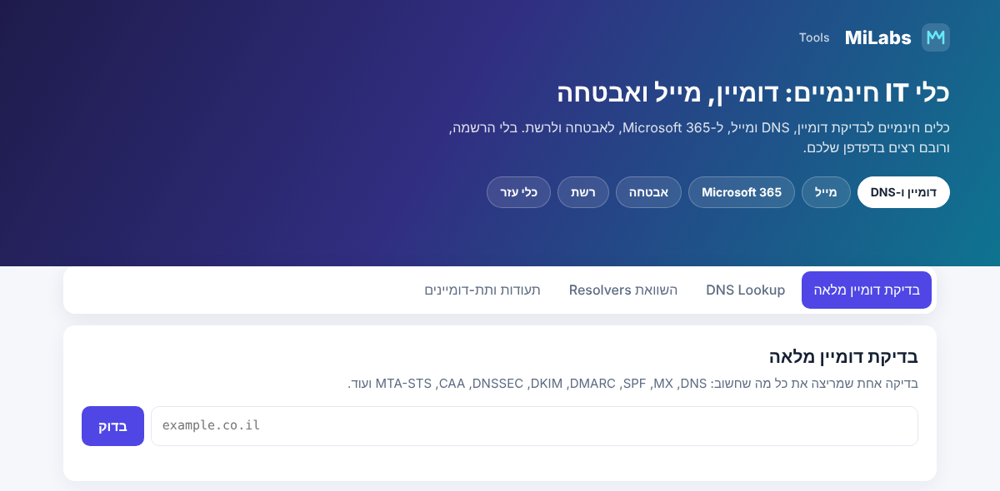

# Free IT Tools by MiLabs

**23 free tools for DNS, email deliverability, Microsoft 365, security and networking. No sign-up, no cookies, no tracking.**

🔗 **Live site:** [English](https://tools.milabs.co.il/en/) · [עברית (Hebrew)](https://tools.milabs.co.il/)
🏢 **Built by:** [MiLabs](https://milabs.co.il), IT, security and automation services



> Available in English (`/en/`) and Hebrew (`/`). The screenshots below show the Hebrew (right-to-left) interface.

---

## Tools

### Domain & DNS
| Tool | What it does |
|---|---|
| **Full domain check** | One-click health report: NS, MX (with provider detection), SPF, DMARC, DKIM, DNSSEC, CAA, MTA-STS, TLS-RPT and BIMI, with a score. |
| **DNS lookup** | A, AAAA, CNAME, MX, NS, TXT, SOA, CAA, SRV, DS, DNSKEY and HTTPS records. Enter an IP to get its reverse DNS (PTR) record. |
| **Resolver comparison** | Runs the same query against several public resolvers to check whether a DNS change has propagated, and shows the remaining TTL. |
| **Certificates & subdomains** | Searches Certificate Transparency logs (via crt.sh). Finds forgotten subdomains and certificates that are about to expire. |

### Email
| Tool | What it does |
|---|---|
| **SPF checker** | Follows every `include` recursively, counts DNS lookups against the 10-lookup limit, and flags `+all`, `ptr`, void lookups and duplicate records. |
| **SPF generator** | Build a record from common senders: Microsoft 365, Google Workspace, Zoho, SES, SendGrid, Mailchimp, Brevo and more. Can count lookups live. |
| **DMARC checker** | Parses every tag, explains it, and handles policy inherited from the organizational domain and external report authorization. |
| **DMARC generator** | Guided record builder with recommendations for rolling out from `none` to `reject`. |
| **DMARC report analyzer** | Drop aggregate reports (`.xml`, `.gz` or `.zip`) and see who sends mail as your domain, with pass rates per source IP and reverse DNS. |
| **Blacklist check** | Checks a mail server's IP – or a domain's MX servers – against public DNS blocklists (SpamCop, UCEPROTECT, PSBL, Mailspike, DroneBL, NiX Spam, s5h.net), with links to Spamhaus and Barracuda's own lookups. |
| **DKIM checker** | Checks a specific selector, or scans about 30 common ones. Reports the RSA key length. |
| **Email header analyzer** | SPF/DKIM/DMARC results, the hop-by-hop route with delays, and Microsoft SCL / spam headers. |

### Microsoft 365
| Tool | What it does |
|---|---|
| **M365 domain check** | Tenant ID lookup, MX, Autodiscover, SPF, DKIM (selector1/2), DMARC, and Intune / Entra join records. |
| **M365 DNS generator** | Every record needed to connect a domain to Microsoft 365, each with a copy button. |

### Security
| Tool | What it does |
|---|---|
| **SSL certificate check** | Connects to a website or VPN portal and reports expiry, chain trust, hostname match, supported TLS versions (1.0–1.3) and key size. |
| **Certificate & CSR decoder** | Paste PEM to see the subject, SANs, issuer, validity, key type and size, key usage / EKU, and SHA-1 and SHA-256 fingerprints. Refuses to process private keys. |
| **Password generator** | Uses `crypto.getRandomValues`, can exclude ambiguous characters, and shows an entropy meter. |
| **JWT decoder** | Decodes the header and payload, shows expiry, and explains Microsoft Entra ID claims (`tid`, `oid`, `scp`, `roles`, `amr`, …). |

### Network & utilities
| Tool | What it does |
|---|---|
| **What's my IP** | Your public IP address and its reverse DNS. |
| **Subnet calculator** | IPv4 (CIDR or dotted mask) and IPv6: network, broadcast, host range, wildcard, binary view and a subnetting table. |
| **Encode & hash** | Base64, Base64URL, URL encoding, Hex, MD5, SHA-1, SHA-256 and SHA-512, all UTF-8 safe. |
| **QR generator** | URL / text, Wi-Fi network and email codes. Download as PNG or SVG. |
| **What's my browser** | Browser, OS, screen, language and time zone, with a one-click copy for support tickets. |

## Screenshots

| SPF generator | Subnet calculator |
|---|---|
|  |  |
| **JWT decoder** | **Certificate decoder** |
|  |  |

## Privacy

- **Nothing is sent to MiLabs.** There is no backend, no analytics and no cookies.
- **DNS queries** go directly from your browser to public DNS-over-HTTPS resolvers (Cloudflare and Google, plus a few others for the resolver comparison).
- **Certificate search** queries [crt.sh](https://crt.sh) directly from your browser.
- **The Microsoft 365 tenant lookup** reads Microsoft's public OpenID configuration endpoint.
- **Fonts** (Heebo, JetBrains Mono) are served from the site itself – no Google Fonts or other third-party requests.
- **Three tools go through our server** (SSL check, blacklist check, What's my IP): it receives the domain or IP you entered and sees your IP address. Nothing is stored; a per-IP request counter is kept in memory for one minute to prevent abuse. Blocklists and checked servers see our server's address, not yours.
- **Everything else stays on your device:** header analysis, DMARC reports, certificate and JWT decoding, passwords, hashing and QR codes. You can confirm this by reading the source.

## How it works

Each language is a single, dependency-free HTML file (`index.html` for Hebrew, `en/index.html` for English): plain HTML, CSS and JavaScript, with no build step. The three server-side tools call a small serverless function on Zoho Catalyst (not included in this repository); the rest of the site works without it. DNS lookups use the [DNS-over-HTTPS JSON API](https://developers.cloudflare.com/1.1.1.1/encryption/dns-over-https/make-api-requests/dns-json/). Certificates are parsed with a small built-in ASN.1/X.509 decoder.

### Run it yourself

```bash
# any static web server works, for example:
npx serve .
# or
python3 -m http.server 8080
```

Serve it over HTTP or HTTPS. Opening the file directly from disk works for the offline tools, but some browsers block DNS requests from `file://`.

## Accessibility

The site targets WCAG 2.1 level AA (Israeli standard IS 5568). All 23 tools, in both languages, passes automated axe-core checks with results rendered, and the whole site can be used with a keyboard alone. See the [accessibility statement](https://tools.milabs.co.il/en/accessibility.html).

## Deep links

Each tool has its own URL, and domain-based tools accept a domain:

```
https://tools.milabs.co.il/en/#health/example.com
https://tools.milabs.co.il/en/#spf/example.com
https://tools.milabs.co.il/en/#subnet
```

## License

[GNU AGPL-3.0](LICENSE). You may use, study and modify this code. If you run a modified version as a public service, you must publish your source code under the same license.

Bundled third-party code and fonts:
- [qrcode-generator](https://github.com/kazuhikoarase/qrcode-generator) 1.4.4 by Kazuhiko Arase – MIT license
- [Heebo](https://github.com/OdedEzer/heebo) and [JetBrains Mono](https://github.com/JetBrains/JetBrainsMono) – SIL Open Font License 1.1 (see `fonts/`)

---

Need help fixing what these tools found? **[MiLabs](https://milabs.co.il)** handles email deliverability, Microsoft 365, DNS and security for businesses.
